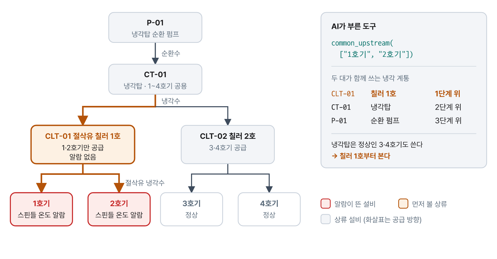
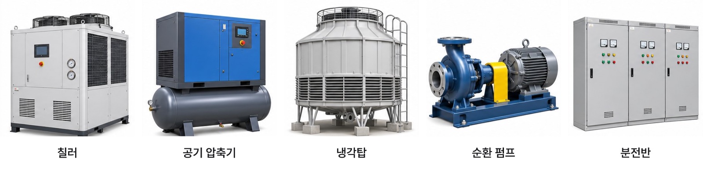

# factory-graph-mcp

**설비에 알람이 떴을 때, 어디부터 봐야 하는지 짚어 주는 MCP 서버입니다.**



공장 설비는 혼자 돌지 않습니다. 가공기는 칠러에서 절삭유 냉각수를, 압축기에서 압축공기를, 분전반에서 전기를 받습니다. 그래서 알람이 뜬 설비가 원인이 아닐 때가 많습니다. 원인은 그 설비에 무언가를 공급하는 **상류** 설비에 있고, 상류 설비는 아직 자기 기준에 닿지 않아 **알람이 없을 수도** 있습니다.

`factory-graph-mcp`는 설비 대장과 연결 테이블(CSV 두 개)을 읽어, AI가 이 연결을 따라 올라갈 수 있게 도구로 줍니다. Claude, Codex, Cursor처럼 MCP를 지원하는 AI 앱에 붙이면 이렇게 물어볼 수 있습니다.

> 1호기랑 2호기에 동시에 스핀들 온도 알람이 떴어. 어디부터 봐야 해?

```text
common_upstream(["1호기", "2호기"], kinds=["절삭유 냉각수", "냉각수", "순환수"])

CLT-01  절삭유 칠러 1호   두 대 모두 공급   1단계 위
CT-01   냉각탑            두 대 모두 공급   2단계 위
P-01    냉각탑 순환 펌프  두 대 모두 공급   3단계 위
```

두 대가 함께 쓰는 냉각 계통은 칠러 1호, 냉각탑, 순환 펌프입니다. 3·4호기가 멀쩡하다면 3·4호기와 함께 쓰는 냉각탑보다 **1·2호기만 쓰는 칠러 1호**를 먼저 보는 것이 맞습니다. 이런 판단은 AI가 이 결과와 현장 상황을 보고 합니다. 이 서버는 연결을 빠짐없이, 틀리지 않게 따라가는 일만 맡습니다.

### 알람이 없는 상류

상류 설비는 고장 나기 전에 먼저 약해집니다. 칠러의 응축기에 먼지가 끼면 열을 덜 내보내서 냉각수 온도가 천천히 오르지만, 칠러 자기 알람 기준에 닿기 전까지는 조용합니다. 그사이 기준이 더 촘촘한 가공기가 먼저 알람을 띄웁니다. 알람 목록만 보면 칠러는 보이지 않습니다.


그래서 알람이 뜬 설비만이 아니라, 그 설비에 무언가를 보내는 설비를 함께 봐야 합니다. 대개 아래 같은 공용 설비입니다.



## 도구

모든 도구는 읽기 전용입니다. 데이터 파일을 바꾸지 않습니다.

| 도구 | 하는 일 |
|---|---|
| `find_equipment` | "1호기", "칠러1"처럼 현장에서 부르는 이름으로 설비 번호를 찾는다 |
| `get_equipment` | 설비 한 대의 정보와 바로 붙은 연결(받는 것, 주는 것) |
| `trace_upstream` | 한 설비에서 상류를 가까운 순서로 따라간다. 무엇이 어떤 길로 흘러오는지(`path`)까지 |
| `common_upstream` | 여러 설비에 동시에 이상이 있을 때 함께 쓰는 상류를 묶는다 |
| `describe_plant` | 불러온 공장의 규모(설비 수, 연결 종류) |

서로 주고받는 연결(예: 기계가 온도 조절기에 전원을 주고, 조절기가 기계에 온수를 주는 경우)이 있어도 끝없이 돌지 않습니다. 한 번 본 설비는 다시 따라가지 않고 `cycles_skipped`에 적어 둡니다.

### 한국어로 만든 첫 제조 설비 MCP 서버

**2026년 11월 24일 기준, 한국어로 만든 첫 제조 설비 MCP 서버입니다.** 해외에는 설비 값을 읽는 OPC UA 서버나 MES 연동 서버가 있지만, 한국어로 된 것은 없었습니다.

현장에서는 설비 번호 대신 "1호기", "칠러2", "콤프"라고 부릅니다. 설비 대장의 `aliases` 열에 이런 이름을 적어 두면 AI가 그 말로 설비를 찾습니다. 설비 이름, 연결 종류(전원, 냉각수, 압축공기 …), 도구 안내문까지 한국어로 만들었습니다. 다른 언어로 적은 데이터도 그대로 읽습니다.

설비끼리 무엇을 주고받는지, 현장에서 설비를 뭐라고 부르는지까지 담은 한국어 공장 데이터는 공개된 것을 찾기 어렵습니다. **그래서 바로 돌려 볼 수 있는 한국어 예제 공장 데이터를 함께 공개합니다.** MIT 라이선스이니 자기 공장 데이터를 만들 때 틀로 가져다 쓰셔도 됩니다.

## 설치와 실행

[uv](https://docs.astral.sh/uv/)가 있으면 설치 없이 바로 실행됩니다.

```bash
uvx --from git+https://github.com/prag-ai/factory-graph-mcp factory-graph-mcp --check
```

`--check`는 데이터를 읽어 요약만 찍고 끝냅니다. 처음에는 들어 있는 예제 공장(CNC 가공 공장, 설비 13대)을 읽습니다.

### Claude Desktop

`claude_desktop_config.json`에 넣습니다.

```json
{
  "mcpServers": {
    "factory-graph": {
      "command": "uvx",
      "args": ["--from", "git+https://github.com/prag-ai/factory-graph-mcp", "factory-graph-mcp"]
    }
  }
}
```

내 공장 데이터를 쓰려면 `args` 끝에 `"--data", "/내/공장/폴더"`를 붙입니다.

### Claude Code

```bash
claude mcp add factory-graph -- uvx --from git+https://github.com/prag-ai/factory-graph-mcp factory-graph-mcp
```

### Codex (OpenAI)

```bash
codex mcp add factory-graph -- uvx --from git+https://github.com/prag-ai/factory-graph-mcp factory-graph-mcp
```

명령 대신 `~/.codex/config.toml`에 직접 적어도 됩니다.

```toml
[mcp_servers.factory-graph]
command = "uvx"
args = ["--from", "git+https://github.com/prag-ai/factory-graph-mcp", "factory-graph-mcp"]
```

### Cursor

`.cursor/mcp.json`(프로젝트) 또는 `~/.cursor/mcp.json`(전체)에 Claude Desktop과 같은 형식으로 넣습니다.

```json
{
  "mcpServers": {
    "factory-graph": {
      "command": "uvx",
      "args": ["--from", "git+https://github.com/prag-ai/factory-graph-mcp", "factory-graph-mcp"]
    }
  }
}
```

### 원격(HTTP)으로 띄우기

```bash
factory-graph-mcp --http --host 0.0.0.0 --port 8000      # 주소: http://<서버>:8000/mcp
```

## 내 공장 데이터로 쓰기

CSV 두 개가 든 폴더를 `--data`로 주거나 환경 변수 `FACTORY_GRAPH_DATA`에 적습니다. 엑셀에서 「CSV UTF-8」로 저장하면 됩니다.

**equipment.csv** — 설비 대장. 한 대에 한 행.

| 열 | 필수 | 뜻 | 예 |
|---|---|---|---|
| `equipment_id` | ● | 설비 번호 | `CNC-01` |
| `name` | ● | 이름 | 머시닝 센터 1호기 |
| `type` | ● | 설비 종류 | 머시닝 센터 |
| `aliases` | | 현장에서 부르는 이름. `\|`로 여러 개 | `1호기\|머시닝1` |
| `location` | | 위치 | 가공동 A열 |
| `note` | | 메모 | |

**connections.csv** — 연결 테이블. 한 행이 화살표 하나입니다.

| 열 | 필수 | 뜻 | 예 |
|---|---|---|---|
| `from_id` | ● | 공급하는 설비 | `CLT-01` |
| `to_id` | ● | 공급받는 설비 | `CNC-01` |
| `kind` | ● | 무엇을 공급하는가 | 절삭유 냉각수 |
| `note` | | 메모 | |

`kind`는 자유롭게 적어도 됩니다(전원, 냉각수, 압축공기, 원료, 스팀 …). 같은 것은 같은 말로 적어야 `kinds`로 좁힐 때 걸립니다. 연결이 설비 대장에 없는 번호를 가리키면 서버가 어느 번호인지 알려 주고 시작하지 않습니다.

예제 데이터: [`src/factory_graph_mcp/sample/`](src/factory_graph_mcp/sample/)

## 이 서버가 하지 않는 일

- **원인을 정하지 않습니다.** 어디를 봐야 하는지만 알려 줍니다. 원인 판단과 조치 결정은 현장 확인을 거쳐 사람이 합니다.
- **설비를 조작하지 않습니다.** 설비나 PLC에 연결하지 않고 CSV만 읽습니다.
- **센서 값과 알람 이력은 읽지 않습니다.** 연결 구조만 다룹니다. 실시간 값을 읽는 일은 OPC UA 같은 다른 MCP 서버와 함께 쓰면 됩니다.

## 개발

```bash
uv venv && uv pip install -e ".[dev]"
.venv/bin/python -m pytest
```

## 만든 곳

[prag-ai](https://prag-ai.com) — 제조 현장의 설비 장애 진단을 AI 에이전트로 만드는 일을 합니다.

이 저장소는 그 작업의 한 조각입니다. 전체 진단 시스템은 여러 에이전트가 나눠 맡아, 장애 신고 한 건을 받아 원인 후보와 조치안을 내고 재가동 승인 요청까지 갑니다. 이 시스템은 처음부터 한국어 데이터로 만들고 검증했습니다. 센서와 알람 기록, 정비 기록, 설비 매뉴얼, 사내 메일과 메신저, 현장 사진, 전기·배관 도면이 모두 한국어입니다.

진단 시스템과 우리 공장 데이터 적용은 [prag-ai.com](https://prag-ai.com)으로, 사내교육은 macr@prag-ai.com 으로 문의해 주세요.

## License

MIT

---

## English

**An MCP server that tells an AI where to look first when a machine alarms.**

Machines in a plant depend on each other: a machining center gets coolant from a chiller, compressed air from a compressor, and power from a panel. The machine that raises the alarm is often not the cause. The cause sits **upstream**, and the upstream machine may not have alarmed yet.

`factory-graph-mcp` reads two CSV files (an equipment list and a connection table) and gives an AI read-only tools to walk those connections: `find_equipment`, `get_equipment`, `trace_upstream`, `common_upstream`, `describe_plant`. Cycles are handled. A sample CNC machining plant (13 machines) is bundled.

```bash
uvx --from git+https://github.com/prag-ai/factory-graph-mcp factory-graph-mcp --check
```

Korean-first — as of November 24, 2026, the first Korean-language manufacturing MCP server. Equipment names, shop-floor aliases ("1호기", "콤프"), tool descriptions, and the sample plant are in Korean; data in any other language works too. Use your own data with `--data <folder>` (columns are described above). It does not diagnose, control equipment, or read live sensor data — it narrows down where to look.

<!-- mcp-name: io.github.prag-ai/factory-graph-mcp -->
